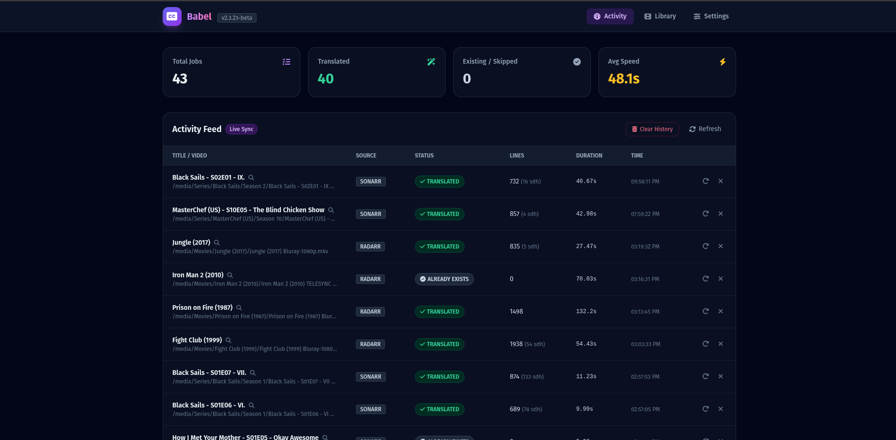
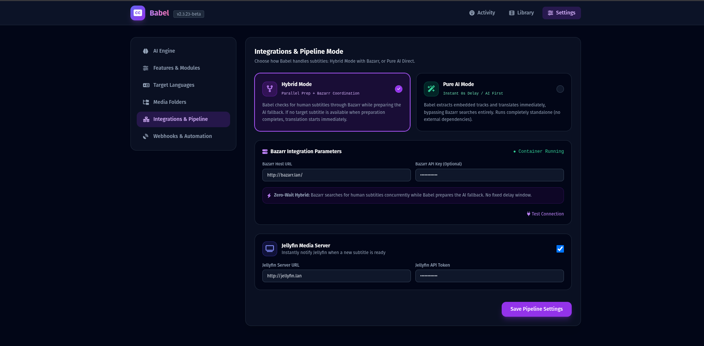
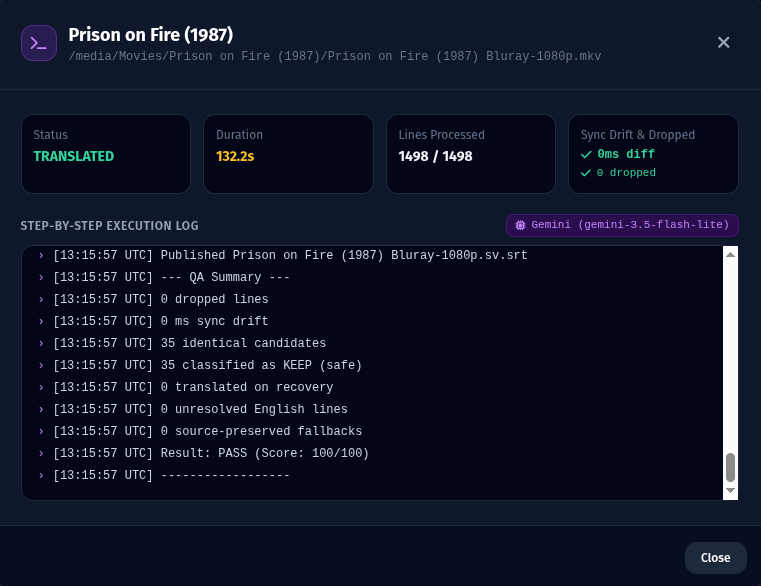
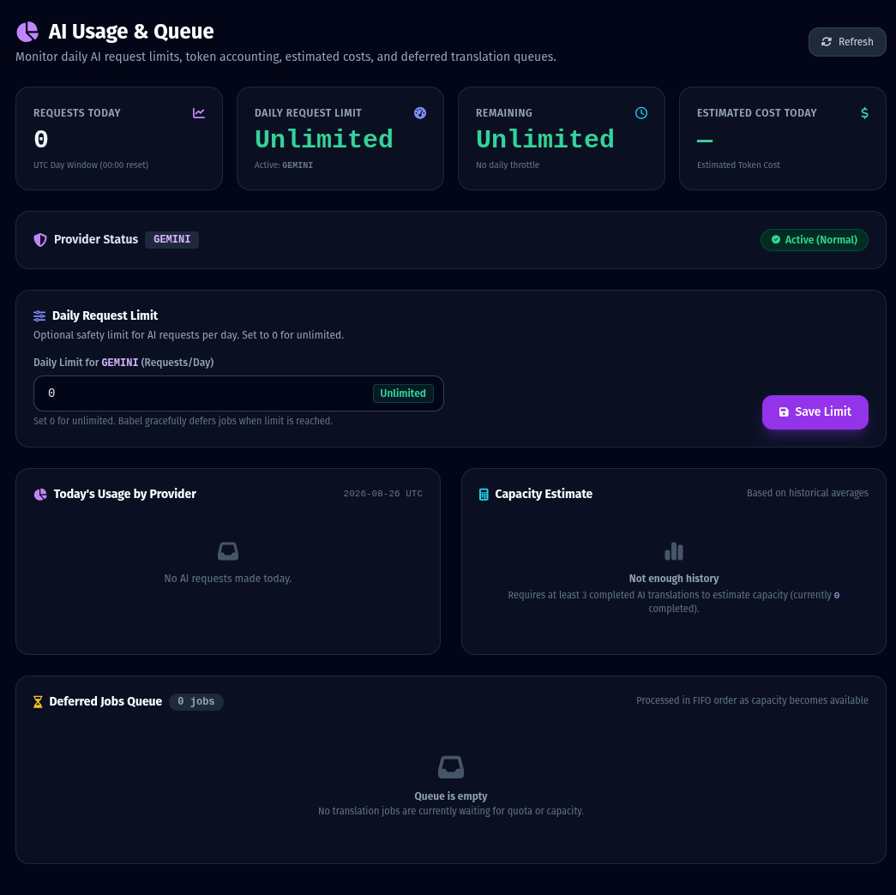

# Babel — Self-Hosted Subtitle Automation

[](https://github.com/hugomossberg/Babel/releases)
[](https://github.com/hugomossberg/Babel/actions/workflows/tests.yml)
[](https://github.com/hugomossberg/Babel/pkgs/container/babel)
[](https://opensource.org/licenses/MIT)

**Babel** is a self-hosted subtitle automation tool for Sonarr, Radarr, Bazarr, and media servers such as Jellyfin.

It looks for subtitles in your preferred language first. If none are available, Babel can use an existing text subtitle track — including one embedded in an MKV — translate it with AI, check the result, and publish it alongside your media.

> **Set it up once. Let Babel handle missing subtitle translations.**

### At a Glance
- **Works with your media stack:** Sonarr/Radarr webhooks, Bazarr coordination, and Jellyfin refresh.
- **Uses existing subtitles:** Embedded or external text tracks; no need to transcribe audio when a suitable source already exists.
- **Translates to your language:** Cloud providers or local Ollama models.
- **Checks the output:** Cue counts, language, structure, timestamps, and targeted recovery when something goes wrong.
- **Preserves source timing:** Translation does not rewrite the source subtitle timestamps.
- **Runs in Docker:** Web dashboard, progress tracking, and provider cost estimates.

---

## Quick Start

Babel runs in Docker. The recommended setup uses **Docker Compose v2** and includes a separate updater container.

```bash
mkdir babel && cd babel
curl -fsSLO https://raw.githubusercontent.com/hugomossberg/Babel/main/docker-compose.yml
curl -fsSLO https://raw.githubusercontent.com/hugomossberg/Babel/main/.env.example
cp .env.example .env
```

Set the **host paths** to your TV shows and movies in `.env`:

```env
TV_PATH=/your/host/path/to/tv
MOVIES_PATH=/your/host/path/to/movies
```

Then start Babel:

```bash
docker compose up -d
```

Open **`http://YOUR-SERVER-IP:8765`** and configure your target language, AI provider, media folders, and integrations.

> **Important:** Babel sees media at `/tv` and `/movies` *inside its container* with the standard Compose setup. Use these container paths in Babel's media settings, not the original host paths.

Need help with mounts, authentication, webhooks, or the updater? See [Detailed Installation](#detailed-installation) and [Sonarr & Radarr Integration](#sonarr--radarr-integration).

---

## Screenshots

See Babel in action — from subtitle discovery and translation to QA, usage tracking, and publishing.

### Activity Dashboard

Monitor automated jobs, processing status, Bazarr matches, cue counts, and translation times.

<p align="center">
  <a href="docs/screenshots/activity-dashboard.png">
    
  </a>
</p>

### Connect-and-Forget Pipeline

Configure Babel once. Babel automatically uses available Bazarr subtitles and falls back to AI translation when needed.

<p align="center">
  <a href="docs/screenshots/pipeline-settings.png">
    
  </a>
</p>

### Verified Output

Every generated subtitle passes Babel's QA gate before it can be published.

<p align="center">
  <a href="docs/screenshots/qa-job-result.png">
    
  </a>
</p>

### AI Usage & Queue

Monitor provider usage, estimated cost, request limits, and deferred translation jobs.

<p align="center">
  
</p>

---

## Why Babel?

Most of the time, the problem isn't that a video has no subtitles at all. It's that the subtitles aren't in the language you want.

Babel is built for that gap. It works alongside Bazarr: let Bazarr look for a suitable subtitle first, and use AI translation as a fallback when there's an existing source track but no matching target language.

AI translations can still skip dialogue, leave lines untranslated, or return broken subtitle structure. Babel checks the output and attempts targeted repairs before publishing. Structural or timing failures block publication; limited unresolved dialogue may be allowed under the configurable **PASS_WITH_WARNINGS** policy.

**What Babel doesn't do (yet):** It does not transcribe speech from audio. For videos with no usable text subtitle track, a speech-to-text tool such as Whisper is the appropriate first step.

---

## Features

### Subtitle Resolution & Extraction
- **Embedded Track Extraction:** Extracts existing text subtitle tracks directly from MKV/MP4 files with `ffmpeg`/`mkvextract`.
- **Existing Subtitle Protection:** Detects existing target language subtitles and skips redundant translation.
- **Bazarr Coordination:** In Hybrid Mode, gives Bazarr a chance to find the requested language before AI translation.
- **Optional Grace Period:** Choose how long new Sonarr/Radarr imports should wait for Bazarr before AI translation starts. The default is 0 hours; see [Advanced Settings](#advanced-settings).
- **Source Fallback:** Uses external source files (such as `.en.srt`) or Bazarr-downloaded source tracks if an embedded source is unavailable.

### AI Translation Engine
- **Multiple Providers:** Gemini, OpenAI, Anthropic, DeepSeek, OpenRouter, DeepL, Ollama, and custom OpenAI-compatible endpoints.
- **Batch Processing:** Processes subtitles in optimal chunks (default: 50 lines) to minimize token overhead and latency while maintaining context.
- **Configurable Request Timeout:** Adjust provider timeouts for slow endpoints and local models; see [Advanced Settings](#advanced-settings).
- **Context-Aware Translation:** Uses dialogue context and optional series-specific glossaries for consistent terminology.

### Multi-Stage Automatic Recovery
- **First-Pass Micro-Repair:** Automatically detects and re-translates missing lines during initial chunk processing.
- **Targeted Dialogue Recovery:** Evaluates unchanged dialogue lines, separating safe invariants (names, entity codes, sound tags) from genuine untranslated speech.
- **Contextual Single-Line Escalation:** Retries stubborn individual lines within their surrounding multi-line dialogue context.
- **Fast Final Rescue:** Batches remaining unresolved lines into a consolidated high-context rescue pass.
- **Deadlock Avoidance:** Prevents infinite recovery loops through strict stagnation detection.

### Source-to-Target Timestamp Preservation
- **0 ms Translation Drift:** Translates subtitles 1:1 cue-by-cue, preserving exact start and end timestamps from the source subtitle file.
- **SDH & Noise Sanitizer:** Conservative pre-processing replaces non-dialogue noise (e.g., `[door closes]`, `♪ music ♪`) with empty formatting tags (`<i></i>`) to maintain subtitle block counts and timing integrity.

### Media Stack Automation
- **Sonarr & Radarr Webhooks:** Automated processing triggered on new media import and upgrade events.
- **Remote Path Mapping:** Built-in path translation for Docker setups with differing host/container mount structures.
- **Jellyfin Notification:** Notifies Jellyfin (`/Library/Refresh`) after publishing so the media library can refresh.
- **Modern Web Dashboard:** Dark-mode management UI with live activity logging, manual file processing, and interactive settings.

---

## How It Works

```text
Media imported (Sonarr / Radarr / Manual)
       │
       ▼
Target subtitle already present?
       │
       ├── Yes ──► Validate / Keep existing
       │
       ▼
[Hybrid Mode] Trigger Bazarr search
while preparing AI fallback in parallel
       │
       ├─► Source resolution
       ├─► Embedded / external source preparation
       ├─► SDH sanitize / normalization
       └─► Source validation
       │
       ▼
Final Target / Bazarr Check
(immediately before first AI provider call)
       │
       ├── Found ──► Adopt human subtitle
       │             AI provider calls = 0
       │
       ▼ Miss
AI Translation in batched chunks
       │
       ▼
Multi-Stage Recovery
(Micro-repair → Targeted recovery → Context escalation)
       │
       ▼
Quality Assurance Gate
       │
       ├── FAIL ──► Block publication & log diagnostics
       │
       ▼
      PASS 
       │
       ▼
Atomic publication (.target.srt)
       │
       ▼
Media Server Refresh
```

---

## Pipeline Modes

### Hybrid Mode (Recommended for mixed libraries)
Babel checks Bazarr for an existing human subtitle while preparing its AI fallback. With the default grace period of 0 hours, there is no additional configured waiting period. You can optionally give Bazarr more time before AI translation starts.

### Pure AI Mode
Babel immediately extracts the embedded source track and translates it with AI, bypassing Bazarr searches entirely.

---

## Quality Assurance Policy

Babel validates every subtitle before writing to disk using a three-tier decision model:

| Result | Criteria | Action |
|---|---|---|
| **`PASS`** | 100% of cues translated or verified safe invariants. 0 dropped lines, 0 ms timestamp drift, verified language match. | Published after validation. |
| **`PASS_WITH_WARNINGS`** | All timing and structural checks pass. By default, allows at most 3 unresolved dialogue cues AND at most 1% of total cues (configurable). Remaining stubborn cues are preserved as source text to avoid deadlock. | Published with warnings recorded. |
| **`FAIL`** | Structural defect, dropped cue blocks, timestamp corruption, excessive untranslated dialogue, or detected wrong language. | **Blocked.** File is not published. |

> **Timestamp Precision Note:** Babel guarantees **source-to-target timestamp preservation** (zero translation-induced timing drift). It preserves the timing relative to the selected source track. If the source subtitle track itself has pre-existing broadcast timing offsets, Babel preserves those timestamps faithful to the source.

---

## Detailed Installation
Install Babel using **Docker Compose v2**. The standard installation includes Babel and the `babel-updater` sidecar for zero-configuration One-Click in-app updates.

> **Prerequisite:** Babel requires Docker with **Docker Compose v2**.
>
> Verify your installation before continuing:
>
> ```bash
> docker --version
> docker compose version
> ```
>
> If `docker compose` is unavailable, install Docker Compose v2 before continuing. The legacy `docker-compose` 1.x package is not recommended and may be incompatible with modern Docker/Python environments.

### 1. Create directory and configuration

Create a directory and download the configuration files:

```bash
mkdir babel && cd babel
curl -O https://raw.githubusercontent.com/hugomossberg/Babel/main/docker-compose.yml
curl -O https://raw.githubusercontent.com/hugomossberg/Babel/main/.env.example
cp .env.example .env
```

Babel requires access to your media files through Docker volume mounts. The recommended approach is to open `.env` and set your host media paths:

```env
TV_PATH=/your/host/path/to/tv
MOVIES_PATH=/your/host/path/to/movies
```

*(Setting `.env` is recommended for simplicity, but optional — advanced users can edit volume mounts directly in `docker-compose.yml`.)*

All other `.env` values are optional. Almost all application configuration (such as AI providers, API keys, target languages, and integrations) is managed directly in Babel's web UI.

Or copy this standard `docker-compose.yml`:

```yaml
services:
  babel:
    image: ghcr.io/hugomossberg/babel:beta
    container_name: babel
    ports:
      - "${BABEL_PORT:-8765}:8765"
    environment:
      - TZ=${TZ:-UTC}
      - BABEL_AUTH_USERNAME=${BABEL_AUTH_USERNAME:-}
      - BABEL_AUTH_PASSWORD=${BABEL_AUTH_PASSWORD:-}
      - BABEL_WEBHOOK_SECRET=${BABEL_WEBHOOK_SECRET:-}
      - "BABEL_UPDATER_SECRET=${BABEL_UPDATER_SECRET:-}"
    volumes:
      - ./data:/app/data
      - babel_updater_auth:/app/auth:ro
      - ${TV_PATH:-/path/to/tv}:/tv
      - ${MOVIES_PATH:-/path/to/movies}:/movies
    restart: unless-stopped
    healthcheck:
      test: ["CMD-SHELL", "curl -f http://localhost:8765/health || exit 1"]
      interval: 30s
      timeout: 5s
      retries: 3
      start_period: 10s

  babel-updater:
    image: ghcr.io/hugomossberg/babel:beta
    container_name: babel-updater
    command: python /app/app/updater/main.py
    environment:
      - BABEL_CONTAINER_NAME=babel
      - ALLOWED_IMAGE=ghcr.io/hugomossberg/babel
      - "BABEL_UPDATER_SECRET=${BABEL_UPDATER_SECRET:-}"
    volumes:
      - /var/run/docker.sock:/var/run/docker.sock
      - babel_updater_auth:/app/auth
    restart: unless-stopped

volumes:
  babel_updater_auth:
```

> **IMPORTANT: Host Paths vs. Container Paths**
>
> Docker determines which host folders Babel can access. Babel's web UI operates with **paths inside the container**, not host paths.
>
> With the standard Compose setup:
> ```text
> Host Path                      Babel Container Path
> TV_PATH=/srv/media/Series   -> /tv
> MOVIES_PATH=/srv/media/Movies -> /movies
> ```
> - In **Settings → Media Root Folders**, enter the internal container paths: `TV Series Path: /tv` and `Movies Path: /movies`.
> - If you configure custom volume mounts (e.g. `- /srv/media/Series:/media/Series`), enter the matching internal path (`/media/Series`).
> - *Note:* The web UI cannot create Docker volume mounts; it can only access folders that Docker has already mounted into the container.
>
> **Container Isolation:** The main `babel` container has **no** access to the Docker socket. `docker.sock` is mounted strictly to the isolated `babel-updater` sidecar.

### 2. Start and Verify

Start Babel in the background:

```bash
docker compose up -d
```

Verify that the container is healthy:

```bash
docker compose ps
curl -f http://localhost:8765/health
```

### 3. Open the Web UI

Navigate to `http://YOUR-SERVER-IP:8765` in your browser.

Configure your preferred settings:
1. **AI Provider & Key** (e.g. Gemini, OpenAI, DeepL, or Ollama)
2. **Target Languages** (e.g. Swedish, German, Spanish, etc.)
3. **Media Folders** (`/tv` and `/movies`)
4. **Integrations** (Sonarr, Radarr, Bazarr, Jellyfin)

---

## Sonarr & Radarr Integration

Babel can process media automatically upon file import or upgrade.

> **Docker Networking Note:** Using `http://YOUR-SERVER-IP:PORT` is the safest option when Sonarr/Radarr and Babel are running in separate Docker stacks.

If `BABEL_WEBHOOK_SECRET` is configured, you can either pass `?secret=YOUR_SECRET` in the URL or add the following custom header:

`X-Webhook-Secret: YOUR_SECRET`

### Sonarr Configuration
1. In Sonarr, navigate to **Settings > Connect > + (Add Webhook)**.
2. Set **URL** to: `http://YOUR-SERVER-IP:8765/webhook/sonarr` (or the dynamic URL shown in Babel settings).
3. If using `BABEL_WEBHOOK_SECRET`, add `?secret=...` to the URL or add the `X-Webhook-Secret` custom header under the webhook's advanced settings.
4. Check triggers: **On File Import** and **On File Upgrade** *(do not use On Grab, as media must be imported to disk first)*.

### Radarr Configuration
1. In Radarr, navigate to **Settings > Connect > + (Add Webhook)**.
2. Set **URL** to: `http://YOUR-SERVER-IP:8765/webhook/radarr` (or the dynamic URL shown in Babel settings).
3. If using `BABEL_WEBHOOK_SECRET`, add `?secret=...` to the URL or add the `X-Webhook-Secret` custom header under the webhook's advanced settings.
4. Check triggers: **On File Import** and **On File Upgrade** *(do not use On Grab, as media must be imported to disk first)*.

### Remote Path Mapping

Remote Path Mapping is **not** a volume mount and does not grant Babel access to new files. It is only required when Sonarr or Radarr reports a file path formatted differently than how Babel sees that same file inside its container.

For example, if Sonarr reports an imported file as:
`/data/media/Series/Show/episode.mkv`

but Babel sees that same media library mounted at:
`/tv/Show/episode.mkv`

Configure Remote Path Mapping in Settings:
- **Remote Path Prefix:** `/data/media/Series` *(path reported by Sonarr/Radarr)*
- **Local Path Prefix:** `/tv` *(corresponding path inside the Babel container)*

*Summary:* **Remote** = path reported by Sonarr/Radarr, **Local** = path inside the Babel container.

---

## Bazarr Integration

Babel **works alongside** Bazarr rather than replacing it. In Hybrid Mode, it checks for subtitles in your preferred language before using AI translation.

To connect Bazarr through its REST API:
- In Settings, enter your **Bazarr Host URL** (e.g. `http://YOUR-SERVER-IP:6767`) and **API Key**.
- Use **Test Connection** to verify connectivity.

---

## Configuration & Environment Variables

Most configuration is handled in the web interface and stored in `/app/data/babel.db`.

### Environment Variables

For advanced deployments, you can specify these environment variables in `.env`:

| Variable | Default | Description |
|---|---|---|
| `BABEL_PORT` | `8765` | Host port to bind the web server |
| `TZ` | `UTC` | Timezone for logs and scheduling |
| `BABEL_AUTH_USERNAME` | *(empty)* | Optional Basic Auth username for web dashboard |
| `BABEL_AUTH_PASSWORD` | *(empty)* | Optional Basic Auth password for web dashboard |
| `BABEL_WEBHOOK_SECRET` | *(empty)* | Optional secret required on webhook requests (`?secret=...`) |
| `BABEL_UPDATER_SECRET` | *(auto-generated)* | (Optional override) Secret for inner-container auth for updates |
| `TV_PATH` | `/path/to/tv` | Host path mounted to `/tv` inside Babel |
| `MOVIES_PATH` | `/path/to/movies` | Host path mounted to `/movies` inside Babel |

### Upgrading an Existing Installation to One-Click Updates

Older single-container installations will not receive `babel-updater` automatically simply by updating the Babel image. To enable One-Click Updates on an existing deployment:

1. **Backup your database first:**
   ```bash
   cp data/babel.db data/babel.db.bak
   ```
2. **Merge the updater configuration into your existing `docker-compose.yml`:**
   Merge the updater definitions from the repository's `docker-compose.yml` without overwriting your custom media mounts or path mappings:
   - Add `babel_updater_auth:/app/auth:ro` under `babel` volumes (read-only).
   - Add the `babel-updater` service with `/var/run/docker.sock:/var/run/docker.sock` and `babel_updater_auth:/app/auth` (read-write).
   - Ensure **no host ports** are exposed on `babel-updater`.
   - Add the named volume `babel_updater_auth:` under the top-level `volumes:` section.
3. **Pull and start:**
   ```bash
   docker compose pull
   docker compose up -d
   ```

---

## Updating Babel

For release notes and upgrade changes, check the [GitHub releases](https://github.com/hugomossberg/Babel/releases) and [changelog](CHANGELOG.md).

### Recommended: One-Click In-App Updates
If you use the recommended Docker Compose setup with `babel-updater`:
- Babel automatically checks for new releases when the web UI is opened and periodically in the background.
- When an update is released, an **Update available** badge appears in the header and Settings.
- Click **Update now** (or review changes in "What's new").
- The updater pulls the latest image, replaces the container, and verifies health.
- If health verification fails, the updater automatically rolls back to the previous working container.

### Manual Fallback
You can also update manually via the terminal at any time:

```bash
docker compose pull
docker compose up -d
```

---

## Advanced Settings

### Bazarr Grace Period

Under Settings → Integrations → Bazarr, configure days and hours (up to 365 days) before automatic AI fallback for new Sonarr/Radarr jobs. The default is **0 hours**, preserving immediate preparation. Waiting jobs survive restarts and retain their original start across scans; changing the duration applies from that start. Babel checks for eligible targets at most every 15 minutes during the wait, without repeated Bazarr search requests. At expiry, Bazarr gets another bounded search opportunity before the existing validated AI fallback. **Translate now** or a manual request bypasses the wait on the same job. Grace requires Hybrid Mode and a configured Bazarr API key; disabling either releases waiting jobs. Existing recovery and provider-retry jobs do not acquire a new grace period.

### AI Request Timeout

Under Settings → AI, set **AI Request Timeout (Seconds)** to 1–3600 for slower inference, including CPU-only Ollama. `0` preserves existing provider defaults (60 seconds for Ollama). The override applies to translation, QA, and recovery; it is a per-request transport timeout, and SDK retries may extend total elapsed time. A timeout stops the current pass, keeps completed batch checkpoints, and allows up to three automatic job retries before requiring a manual retry. Increase the timeout or reduce batch size before retrying. QA validation still runs before publication.

---

## Frequently Asked Questions

**Does Babel replace Bazarr?**

No. Babel can work alongside Bazarr, which gets the first chance to find subtitles in your preferred language.

**Can Babel generate subtitles directly from audio?**

Not currently. Babel translates existing text subtitle tracks. Audio transcription needs a separate speech-to-text tool.

**Can I use it on Unraid?**

Babel is distributed as a Docker image, so it can be deployed on Unraid with the appropriate port and media volume mappings. There isn't an official Community Apps template at the moment; the [Docker Compose setup](#quick-start) is the reference.

**Does translation require a paid cloud API?**

Not necessarily. Babel also supports local Ollama models. Translation speed and quality depend on the model, hardware, and language pair.

---

## Development & Local Builds

For developers wanting to contribute or run from source:

### 1. Clone repository
```bash
git clone https://github.com/hugomossberg/Babel.git
cd Babel
```

### 2. Run tests
```bash
python3 -m venv .venv
source .venv/bin/activate
pip install -r requirements.txt pytest pytest-asyncio
pytest -v
```

### 3. Build Docker image locally
```bash
docker build -t babel:local .
```

### 4. Run the complete suite without external network access

The test image adds Node for the Alpine component tests; it does not change the
runtime image. Tests use temporary databases and deterministic provider HTTP
responses. Unmocked external Python network attempts fail the test, including
when application error handling catches the network exception.

```bash
docker build -f tests/Dockerfile --build-arg BABEL_TEST_BASE=babel:local -t babel:tests tests
docker run --rm --network none --read-only --tmpfs /tmp:rw,size=256m,mode=1777 \
  -e BABEL_DB_PATH=/tmp/babel-tests/babel.db \
  -e PYTHONPATH=/app -e PYTHONDONTWRITEBYTECODE=1 \
  -v "$PWD/tests:/app/tests:ro" -v "$PWD/.github:/app/.github:ro" \
  babel:tests python -m pytest -q -p no:cacheprovider
```

Tests use the image version; updater fixtures choose their test releases independently.
The workflow mount supplies source files intentionally excluded
from the runtime image. Neither production data nor a Docker socket is mounted.
For a complete native run, install Node before running pytest as well.

---

## Security

- Babel is designed for private local network / self-hosted homelab environments.
- If exposing Babel outside your local network, always place it behind a secure reverse proxy (e.g. Traefik, Caddy, Nginx Proxy Manager) with HTTPS and authentication.
- API keys entered in the UI are stored locally in `data/babel.db` and are masked in frontend responses.

---

## Contributing

Contributions, issues, and feature suggestions are welcome! Please open an issue or pull request on [GitHub](https://github.com/hugomossberg/Babel).

When reporting a bug, please include:
- Babel version (`vX.Y.Z-beta`)
- AI provider and model used
- Relevant anonymized job log
- Expected vs actual behavior

---

## License

This project is licensed under the [MIT License](LICENSE).

**Author:** [Hugo Mossberg](https://github.com/hugomossberg)
